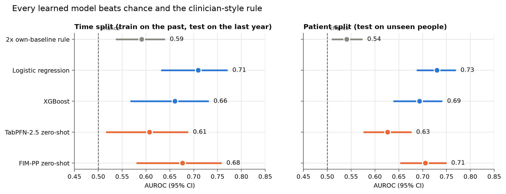
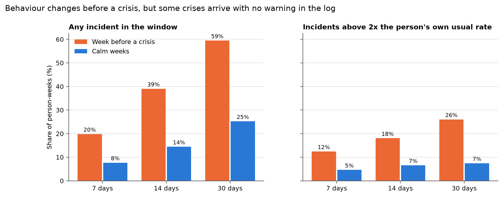
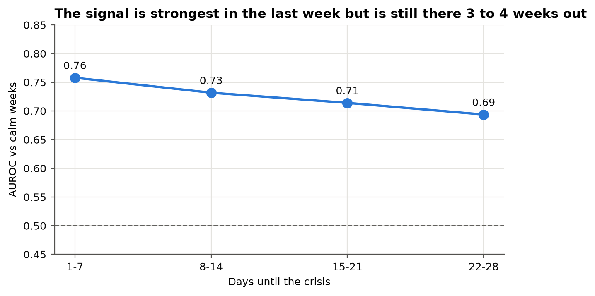
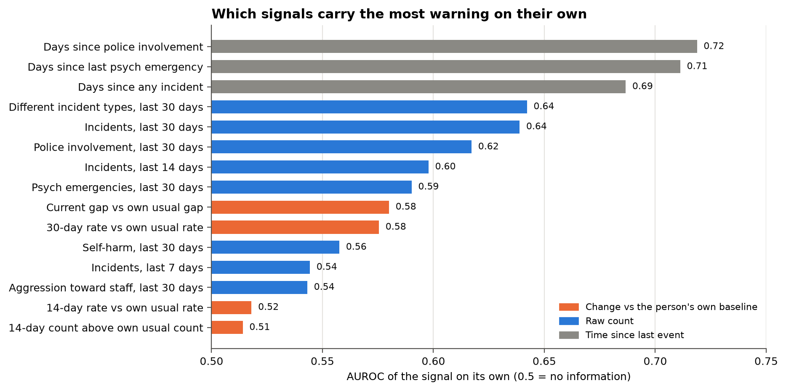
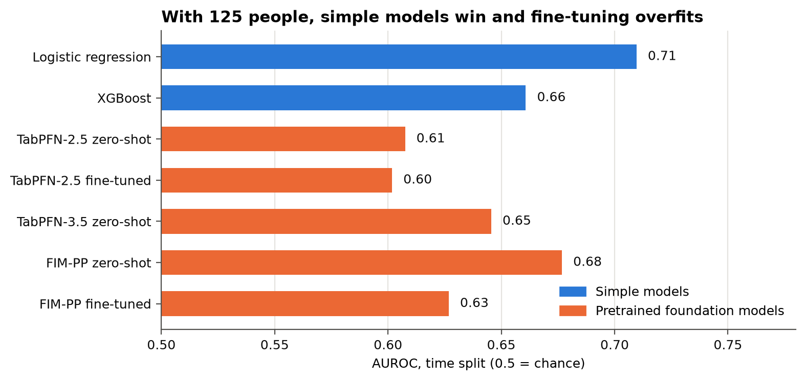

# IDD crisis early warning

**Can the incident reports staff already write tell us, weeks ahead, that a person with an intellectual or developmental disability (IDD) is heading toward a psychiatric crisis?**

Proof of concept for the NSF-sponsored pitched track at Hack-a-Roo Fall 2026 (UMKC). Code, methods and aggregate results only. The patient data never leaves the clinical team's machine (see [data governance](docs/data-governance.md)).

## The problem

Adults with IDD in Missouri group homes and supported living often look stable for weeks, then crash: a psychiatric emergency, an ER visit, police, sometimes the loss of their home placement. Looking back, the warning signs were usually there in the incident reports. Nobody reads those reports as a timeline, one person at a time, so the pattern is easy to miss while it is forming.

Adults with IDD on Medicaid have 2.6 times the ER visit rate and 3.2 times the inpatient admission rate of other adults, and 5.8 to 15 times the rate for psychiatric conditions ([Lauer et al., 2021](https://doi.org/10.1097/JAC.0000000000000373)). Many can't easily describe what they are feeling, so a change in behaviour is often the first visible sign. More in [docs/01-problem.md](docs/01-problem.md).

## Hypothesis and verdict

> **Hypothesis.** Changes in a person's own incident pattern (how often, how close together, what kinds) show up before a psychiatric crisis, early enough to act on.
>
> **Verdict: supported, with a known ceiling.** A simple model trained on 3.7 years of de-identified incident logs (125 people, 3,240 events) ranks the weeks before a crisis above calm weeks with AUROC 0.71 to 0.73, well clear of chance (0.5) and of a clinician-style "2x their usual rate" rule (0.54 to 0.59). The signal is still there 3 to 4 weeks out. About 4 in 10 crises have no incident logged in the month before them, so incident logs alone can't catch everything, and that tells us what data to collect next.



*AUROC (area under the ROC curve) is the chance that the model scores a random crisis week higher than a random calm week. 0.5 is a coin flip, 1.0 is perfect. Bars are 95% confidence intervals from resampling patients.*

## Sprint scorecard

The pitch set seven questions for the four-week sprint. Here is where each one stands.

| # | Question from the pitch | What we found | Status |
|---|---|---|---|
| 1 | Is there a detectable change in behaviour before crises? | Yes. 39% of pre-crisis weeks had an incident in the prior 14 days, against 14% of calm weeks. Over 30 days it is 59% vs 25%. | Answered |
| 2 | Can those changes be told apart from the person's usual baseline? | Partly. A jump above 2x the person's own usual rate is 2.7x more common before a crisis (18% vs 7% over 14 days), but it is rare, so on its own it is a weak alarm (AUROC 0.52 to 0.58). | Partly answered |
| 3 | Which variables are most informative? | How recently this person last had a psychiatric emergency or police involvement (AUROC 0.71 to 0.72 on their own), then how many different incident types occurred in the last 30 days (0.64). | Answered |
| 4 | How far in advance does a signal appear? | It is strongest in the final week (AUROC 0.76) and fades slowly: 0.73 at 8 to 14 days, 0.71 at 15 to 21 days, 0.69 at 22 to 28 days. | Answered |
| 5 | How well can a preliminary model separate crisis from non-crisis periods? | Logistic regression: AUROC 0.71 on the last year of data, 0.73 on people it never saw. Reviewing the top 10 people each week flags 56% of crises beforehand, at about 0.5 false alarms per person per month. | Answered |
| 6 | Where do false positives and false negatives occur? | Crises with no lead-up in the log are missed by design. The error audit found men's crises are missed more often (20% of crisis weeks flagged vs 53% for women) while women get more false alarms. | Answered, needs follow-up |
| 7 | What should be collected in future to do better? | Medication changes, sleep, diagnoses, program start and end dates, and data from more sites. See the [roadmap](docs/04-roadmap.md). | Answered |

Full numbers, every model and every figure: [docs/03-results.md](docs/03-results.md).

<table>
<tr>
<td></td>
</tr>
<tr>
<td> </td>
</tr>
</table>

## What surprised us

We expected pretrained "foundation models" to win. They didn't. TabPFN (a model pretrained on millions of synthetic tables) and FIM-PP (a model pretrained on event timelines) both trailed plain logistic regression. Fine-tuning them on our data made them worse: TabPFN memorised individual people, and FIM-PP dropped from 0.68 to 0.63. With 125 people, the bottleneck is the data, not the model. That is good news for a clinical tool, because the winning model is small, fast and easy to explain.



## Where this goes next

1. **Richer data, same people.** Add medication changes and sleep (the clinical team's top suspects for the crises we can't see), diagnoses, and program enrollment dates.
2. **More people, more sites.** Run the same pipeline at other providers without moving their data ("send the code to the data"), so only aggregate results come back.
3. **A clinician view.** A dashboard that shows one person's timeline against their own baseline band, a green, yellow or red flag, and the top reasons, with the weekly list sized to how many check-ins the team can actually do.
4. **A prospective pilot.** Score people weekly for a few months without acting on it, then check how the flags lined up with real crises.

Details, open questions and partnership asks: [docs/04-roadmap.md](docs/04-roadmap.md).

## Start here (new teammates)

Read in this order:

1. This README
2. [docs/01-problem.md](docs/01-problem.md): the clinical problem and what others have tried
3. [docs/02-approach.md](docs/02-approach.md): how we turned incident logs into a prediction task
4. [docs/03-results.md](docs/03-results.md): every result, including what failed
5. [docs/open-problems.md](docs/open-problems.md): ideas we haven't tried yet (fresh ideas welcome)
6. [docs/lab-notebook.md](docs/lab-notebook.md): the raw dev log and the engineering gotchas

```
src/psych_crisis/
  config.py          windows (7/14/30 days), 28-day horizon, split date, incident categories
  events.py          raw incident rows -> one row per event, coarse setting type
  labels.py          crisis definitions A/B/C and crisis-onset detection
  features.py        weekly person-level table with past-only, self-relative features
  splits.py          time split and leave-patients-out folds
  models/            2x rule, logistic regression, XGBoost, TabPFN
  fimpp_export.py    timelines for the FIM-PP point-process model
  evaluate.py        AUROC / PR-AUC with patient bootstrap CIs, alert workload, fairness audit
  run.py             train + evaluate one model on one split
scripts/
  make_figures.py    builds results/*.csv and docs/figures/*.png (aggregates only)
  fimpp_score.py     zero-shot FIM-PP scoring (runs in its own environment)
  strip_free_text.py removes staff free-text notes from the working copy
tests/               pipeline tests on small made-up timelines
results/             aggregate result tables (no patient rows)
docs/                write-ups and figures
```

How to run (needs Python 3.11+ and [uv](https://docs.astral.sh/uv/)):

```bash
uv sync
uv run pytest                                                 # 10 tests, synthetic data, no patient data needed
uv run python -m psych_crisis.run --model logistic --split time   # needs data/raw/incidents.csv
uv run python scripts/make_figures.py                         # needs local outputs/ and data/
```

The incident data is not in this repo and can't be shared. The tests run on made-up timelines, so you can read and change the pipeline without it. A synthetic dataset generator is planned so anyone can run the full pipeline.

## Team

| Role | Name |
|---|---|
| Pitcher and clinical lead | [TODO] |
| Clinical research and literature | [TODO] |
| Data pipeline, modelling, evaluation | [TODO] |
| [TODO] | [TODO] |
| Faculty mentors | [TODO] |

## Credits

- [TabPFN](https://github.com/PriorLabs/TabPFN) (Prior Labs), run locally. No data was sent to any cloud API.
- [FIM-PP / OpenFIM](https://github.com/FIM4Science/OpenFIM), a foundation model for point processes.
- The study design borrows the crisis-onset definition, 28-day horizon and time split from [Garriga et al., 2022, Nature Medicine](https://doi.org/10.1038/s41591-022-01811-5), and the fairness audit from [Wang et al., 2026, npj Mental Health Research](https://doi.org/10.1038/s44184-026-00194-6).

## Disclaimer

This is research software for a feasibility study. It is decision support, not diagnosis, and it is not validated for clinical use.

Code is released under the [MIT License](LICENSE).
