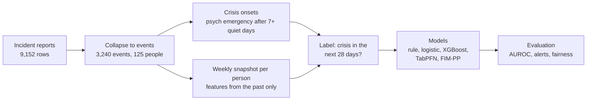

# Approach

## Pipeline

## The data (aggregates only)

De-identified incident reports from the Missouri DMH critical-events system, shared by the clinical lead from her own program.

| | |
|---|---|
| Rows | 9,152 (one row per incident type within an event) |
| Events | 3,240 (mean 2.5 incident types per event) |
| People | 125 (80 men, 45 women), ages 14 to 68, median 30 |
| Time span | January 2023 to September 2026 (about 3.7 years) |
| Events per person | median 13, maximum 174 |
| Psychiatric emergency events | 531, across 90 people |

There are no medication, sleep, diagnosis or vital-sign fields. Everything below uses incident reports only.

Things we had to handle:

- **One event, many rows.** A single event is split into one row per incident type. We collapse to one row per (person, date, time) with a flag per incident category, before counting anything.
- **The outcome lives in the same log as the predictors.** Psychiatric emergencies are both what we predict and part of the history. Features only use events strictly before the prediction date.
- **No record is not the same as calm.** People join and leave programs and we don't have enrollment dates.
- **Inpatient stays.** Events during an inpatient program don't count as crises (the person is already in care), but the stay is recorded as a feature.
- **Staff free text.** Two list columns had typed notes. We strip them from the working copy (`scripts/strip_free_text.py`) before modelling.

## What counts as a crisis

Three candidate definitions, chosen by the clinical lead:

| Label | Definition | Used here |
|---|---|---|
| A | Psychiatric emergency | Yes (default) |
| B | A or police involvement | Code ready |
| C | B or ER required or hospitalisation | Code ready |

A **crisis onset** is a label-A event in the community that comes at least 7 days after the person's previous crisis. Back-to-back events count as one episode (this follows Garriga et al., 2022).

## The prediction task

Every Monday, for every person with at least 90 days of history, we take a snapshot and ask: **will this person have a crisis onset in the next 28 days?** Weeks right after a crisis (within 7 days) are skipped, so the model predicts new episodes, not the tail of the current one.

That gives 11,043 person-weeks, 8.9% of them followed by a crisis.

## Features: relative to each person's own past

With a median of 13 events per person, we can't train one model per person. Instead, one model is trained across everyone, and most features compare the person with their own history. This keeps the clinical idea of a personal baseline and also tests whether there is a pattern shared across people.

| Feature group | Examples |
|---|---|
| Recent counts | incidents in the last 7, 14 and 30 days; behaviour incidents only |
| Change from own baseline | 7/14/30-day count divided by the person's usual rate; count above their usual count |
| Timing | days since the last incident, psych emergency, police involvement, restraint, self-harm; current gap vs the person's usual gap between incidents |
| Mix | count of each category (aggression, self-harm, police, restraint, and so on) in the last 30 days; number of different incident types in 30 days |
| History | running totals of incidents and crises, days of history |
| Context | age, gender, setting type (group home, ISL, recent inpatient). No program or organisation names |

A variant replaces running totals with yearly rates ("stationary" features), to check whether drift over calendar time explains any results.

## Models

| Model | What it is | Why we tried it |
|---|---|---|
| 2x rule | Flag when the 14-day rate is above twice the person's usual rate | What a careful clinician might do by hand. The bar to beat |
| Logistic regression | Weighted sum of features, scaled to a probability | Simple, easy to explain |
| XGBoost | Gradient-boosted decision trees | Strong default for tables, best model in Garriga et al. |
| TabPFN 2.5 / 3.5 | A transformer pretrained on millions of synthetic tables; predicts on new tables with no training ("zero-shot") | Designed for small datasets like ours |
| FIM-PP | A foundation model for point processes (models of when events happen), pretrained on synthetic event timelines | Reads each person's event timeline directly instead of hand-made features |

We also tried fine-tuning (further training on our data) both pretrained models, and feeding the FIM-PP score into logistic regression and XGBoost.

TabPFN runs locally (`tabpfn`, never the cloud client). FIM-PP needs an older `transformers` version, so it runs in its own environment and exchanges parquet files with this one (`src/psych_crisis/fimpp_export.py`, `scripts/fimpp_score.py`).

## Evaluation

- **Time split.** Train on weeks whose 28-day window ends before 1 October 2025, test on weeks from then on (2,960 weeks, 91 people, 12.9% positive). This is how a deployed tool would be used: learn from the past, predict the future.
- **Patient split.** 5-fold cross-validation where each person is in exactly one test fold (11,043 weeks, 109 people). Tests whether the model works for people it has never seen.
- **Metrics.** AUROC (ranking quality, 0.5 = chance), PR-AUC (precision-recall area, more sensitive to rare positives; compare with the positive rate of 0.09 to 0.13), Brier score (accuracy of the probabilities, lower is better). 95% confidence intervals come from resampling whole patients 1,000 times, since weeks from one person are correlated.
- **Alert workload.** If the team can review the top 5 or top 10 people each week, what share of crises gets a flag in the 28 days before, and how many false alarms per person per month?
- **Fairness audit.** True and false positive rates by gender, age band and setting, at the top-10 alert level. Groups with fewer than 11 people are not reported.

We fixed the list of runs before looking at test results and stopped tuning after it. Every extra variant scored on the same test set makes the best number look better than it is.
