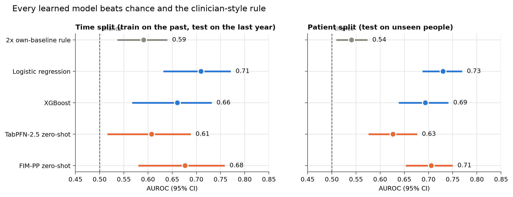
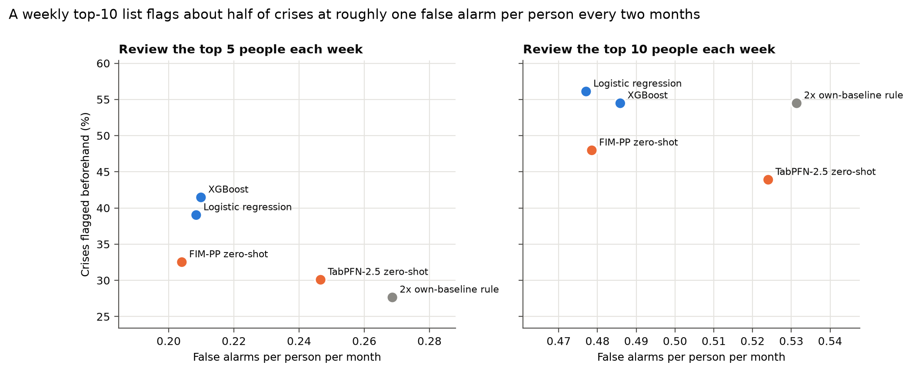
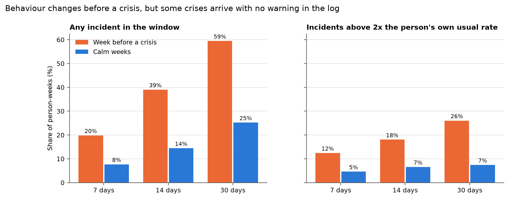
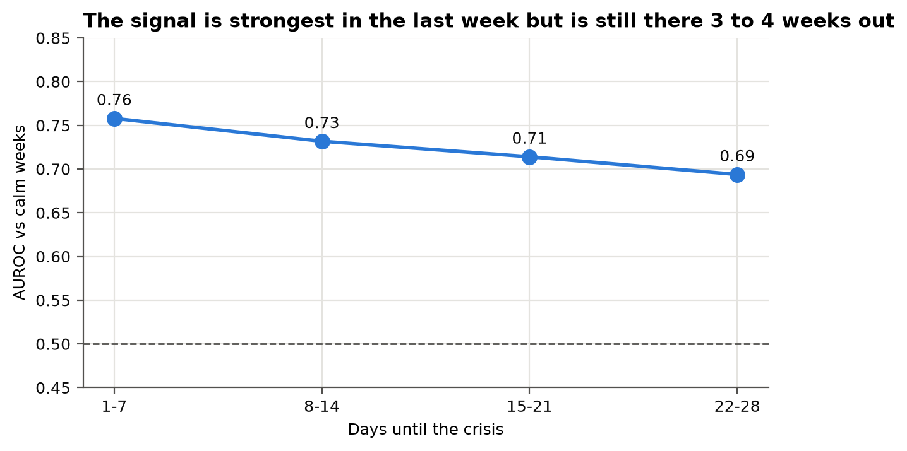
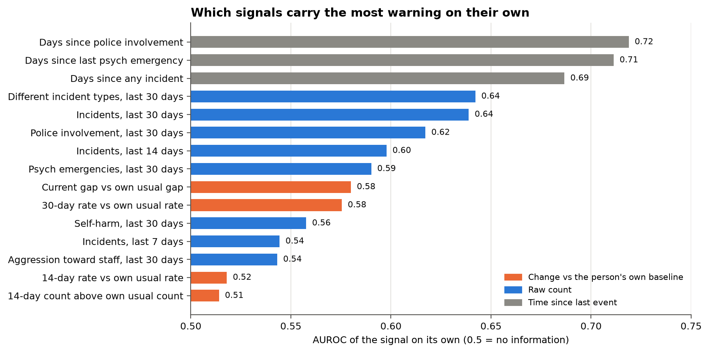
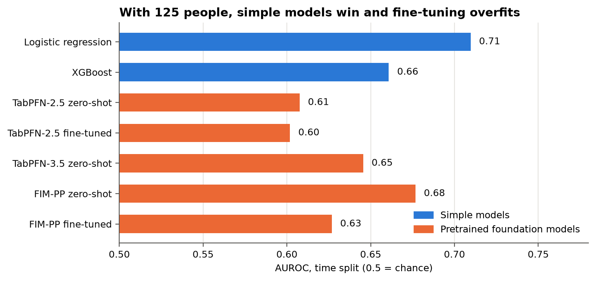
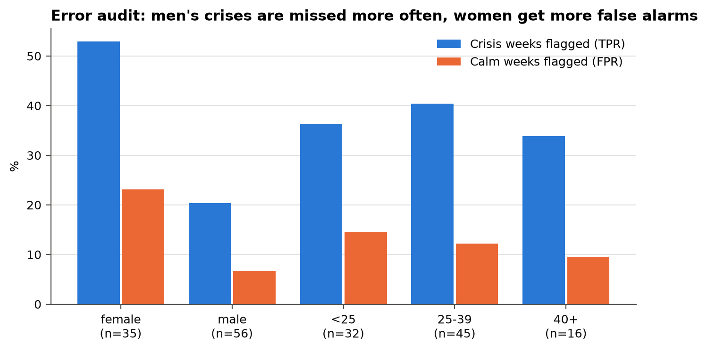

# Results

All numbers come from `results/*.csv`, which `scripts/make_figures.py` builds from the local model outputs. Crisis label A (psychiatric emergency onset in the next 28 days).

## 1. Every learned model beats chance and the clinician-style rule

| Model | Time split AUROC (95% CI) | Time split PR-AUC | Patient split AUROC (95% CI) | Patient split PR-AUC |
|---|---|---|---|---|
| 2x own-baseline rule | 0.59 (0.54 to 0.64) | 0.20 | 0.54 (0.51 to 0.57) | 0.13 |
| **Logistic regression** | **0.71 (0.63 to 0.77)** | **0.31** | **0.73 (0.69 to 0.77)** | **0.24** |
| Logistic (yearly rates) | 0.72 (0.64 to 0.78) | 0.32 | | |
| Logistic + FIM-PP score | 0.70 (0.62 to 0.76) | 0.31 | | |
| XGBoost | 0.66 (0.57 to 0.73) | 0.28 | 0.69 (0.64 to 0.74) | 0.21 |
| XGBoost (yearly rates) | 0.68 (0.59 to 0.75) | 0.31 | | |
| XGBoost + FIM-PP score | 0.67 (0.58 to 0.74) | 0.28 | | |
| TabPFN-2.5 zero-shot | 0.61 (0.52 to 0.69) | 0.19 | 0.63 (0.58 to 0.68) | 0.14 |
| TabPFN-2.5 (yearly rates) | 0.60 (0.52 to 0.68) | 0.19 | | |
| TabPFN-2.5 fine-tuned | 0.60 (0.52 to 0.68) | 0.20 | | |
| TabPFN-3.5 zero-shot | 0.65 (0.55 to 0.73) | 0.25 | | |
| FIM-PP zero-shot | 0.68 (0.58 to 0.76) | 0.29 | 0.71 (0.65 to 0.75) | 0.22 |
| FIM-PP fine-tuned | 0.63 (0.54 to 0.71) | 0.20 | | |

Positive rate: 12.9% of weeks in the time split, 8.9% in the patient split. A PR-AUC of 0.31 against a base rate of 0.13 means the model's top-ranked weeks are about 2.4 times as likely to precede a crisis as a random week.

For reference, Garriga et al. (2022) reached AUROC 0.80 with full hospital records for 17,122 patients. We reach 0.71 to 0.73 with incident reports alone for 125 people.

## 2. A weekly review list catches about half of crises

| Model (time split) | Top 5 per week: crises flagged | False alarms per person-month | Top 10 per week: crises flagged | False alarms per person-month |
|---|---|---|---|---|
| 2x rule | 28% | 0.27 | 54% | 0.53 |
| Logistic regression | 39% | 0.21 | 56% | 0.48 |
| XGBoost | 41% | 0.21 | 54% | 0.49 |
| TabPFN-2.5 zero-shot | 30% | 0.25 | 44% | 0.52 |
| FIM-PP zero-shot | 33% | 0.20 | 48% | 0.48 |

A crisis counts as flagged if the person was on the weekly list at least once in the 28 days before it. The rule catches nearly as many crises at the top-10 level but with more false alarms, and it falls well behind at the top-5 level, where ranking matters most.

## 3. Behaviour does change before a crisis

Comparing the week right before a crisis (338 person-weeks, 76 people) with weeks not followed by a crisis (10,058 person-weeks):

| Window | Any incident: before crisis | Any incident: calm | Above 2x own rate: before crisis | Above 2x own rate: calm | Mean incidents: before / calm |
|---|---|---|---|---|---|
| 7 days | 20% | 8% | 12% | 5% | 0.32 / 0.11 |
| 14 days | 39% | 14% | 18% | 7% | 0.77 / 0.24 |
| 30 days | 59% | 25% | 26% | 7% | 1.71 / 0.54 |

The other side of the same table is the ceiling: 41% of crises have no incident at all in the 30 days before them, and 61% have none in the 14 days before. No model built on incident reports alone can see those. They are the strongest argument for adding medication and sleep data.

## 4. The signal starts weeks ahead

Patient-split logistic model, crisis weeks grouped by how far away the crisis was, each group compared with all calm weeks:

| Days until crisis | Crisis weeks | AUROC vs calm weeks |
|---|---|---|
| 1 to 7 | 338 | 0.76 |
| 8 to 14 | 253 | 0.73 |
| 15 to 21 | 223 | 0.71 |
| 22 to 28 | 171 | 0.69 |

## 5. Which signals matter

Each signal on its own, measured on the time-split training weeks only. The strongest are about this person's recent history: days since their last police involvement (0.72), last psychiatric emergency (0.71) and last incident of any kind (0.69). Next come the number of different incident types in 30 days (0.64) and the 30-day count (0.64).

The "rate vs own usual rate" signals are weak alone (0.52 to 0.58). They do jump before crises (section 3) but they jump for only a minority of crises, and a single unusual week is noisy. Combining signals in a model works better than any one threshold, which is also why the 2x rule loses.

## 6. What didn't work, and what it taught us

- **Pretrained foundation models.** Zero-shot TabPFN (0.61 to 0.65) and FIM-PP (0.68) were below logistic regression. TabPFN with all 7,783 training rows and 8 estimators took 11 minutes and was no better than with 4,000 rows.
- **Fine-tuning made things worse.** TabPFN-2.5 reported 0.986 on its own random-row validation because it memorised people, then scored 0.60 on the test set. FIM-PP fell from 0.68 to 0.63 after fine-tuning on 73 timelines.
- **Drift is not the explanation.** Swapping running totals for yearly rates helped logistic regression and XGBoost a little (0.71 to 0.72, 0.66 to 0.68) and did nothing for TabPFN. The patient split, which has no calendar drift, shows the same TabPFN gap.
- **Adding the FIM-PP score as a feature** didn't help either simple model.

The lesson: with 125 people, the data limits us, not the model. A larger model can't recover a signal that isn't in the log.

## 7. Error audit

Logistic regression, time split, top 10 per week (groups under 11 people not shown):

| Group | People | Crisis weeks flagged (TPR) | Calm weeks flagged (FPR) |
|---|---|---|---|
| Women | 35 | 53% | 23% |
| Men | 56 | 20% | 7% |
| Under 25 | 32 | 36% | 15% |
| 25 to 39 | 45 | 40% | 12% |
| 40 and over | 16 | 34% | 10% |

The model flags women more often in both directions. Women in this cohort have more crisis weeks per person (206 crisis weeks for 35 women vs 177 for 56 men), so a pooled model ranks them higher overall. Possible fixes are group-specific thresholds or adding gender interactions, but either needs clinical input first. We have no race or ethnicity data, so that audit isn't possible here.

Full tables: `results/summary.csv`, `results/fairness.csv`, `results/pre_crisis_vs_calm.csv`, `results/lead_time.csv`, `results/single_signal_auroc.csv`.
