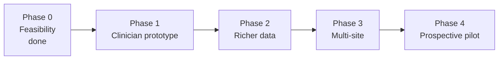

# Roadmap: from proof of concept to a clinical tool

The sprint answered the feasibility question: there is an early warning signal in routine incident reports, it appears weeks ahead, and a small, explainable model finds it. It also showed where the ceiling is. Each phase below targets one of the limits we found.

## Phase 0: feasibility (done, this repo)

- Pipeline from raw incident reports to a weekly risk score
- Six model families compared on two kinds of held-out test
- Answers to the seven sprint questions, including what the data can't tell us

## Phase 1: clinician prototype (next, weeks)

- A dashboard for one person at a time: their incident timeline, a band showing their own usual rate, a green, yellow or red flag, and the top reasons behind the score.
- A weekly review list sized to the team's real capacity (how many check-ins per week can they do?), following the tiered-alert idea of [Alzhouri et al., 2026](https://doi.org/10.1007/s10586-026-06611-x).
- Calibrated probabilities, so "30% risk" means roughly 3 in 10.
- A synthetic dataset with the same columns, so the dashboard and the full pipeline can be shown and tested without patient data.
- Clinical review: the clinical lead walks through 3 to 5 real trajectories and says whether the flags and reasons make sense.

## Phase 2: richer data for the same people (months)

The 41% of crises with no incident in the month before are invisible to this model. The clinical team suspects medication tolerance and poor sleep drive many of them. Data to add, in rough order of expected value:

| Data | Why | Where it might come from |
|---|---|---|
| Medication changes (starts, stops, dose changes, missed doses) | Clinical team's top hypothesis | Program medication records |
| Sleep | Second hypothesis; often logged by overnight staff | Shift notes, sleep logs |
| Program start and end dates | Tells a calm stretch apart from "not in the program" | Enrollment records |
| Diagnoses | Different conditions may have different warning patterns | Clinical records |
| Staffing changes, moves, family visits | Environmental triggers | Provider records |
| Free-text incident narratives (de-identified locally) | Richer than the incident type codes | Already collected, currently stripped |

Also test crisis labels B and C (adding police and ER/hospitalisation) with the clinical team, and a time-to-next-crisis (survival) model.

## Phase 3: more people, more sites (6 to 12 months)

125 people is enough to show a signal and too few to trust the details. Missouri DMH serves many more people through the same incident reporting system, so the same pipeline should run elsewhere with little change.

To avoid moving sensitive data, use a "send the code to the data" model: each provider runs the pipeline on its own machine and shares only aggregate results or model weights (federated learning). The codebase is already split so data loading, features and evaluation are separate steps.

## Phase 4: prospective pilot

Score people weekly for 3 to 6 months without acting on the scores. Then compare flags with what actually happened, and ask clinicians whether the flags would have changed anything (Garriga et al. ran this kind of study with 60 clinicians). Only after that would we consider a pilot where flags reach the care team.

## What we would need from partners

- **Clinical and provider partners:** more data under a formal data use agreement, and clinician time to review flags.
- **Missouri DMH:** permission to extend to other providers using the same incident system.
- **Ethics:** an IRB determination before Phase 2.
- **Funding:** small grant or NRT support for a research assistant and the multi-site work.

## Side project

A scoping review (a structured map of the published work) on AI for psychiatric crisis prediction, with an IDD focus. Proposed by the clinical lead as a second publication.
